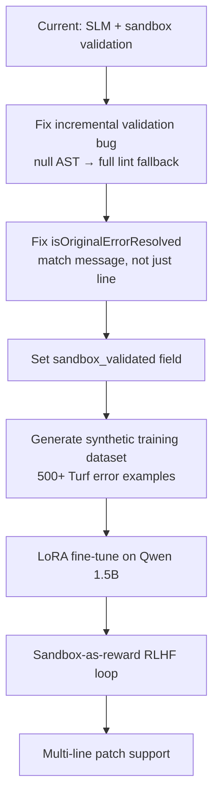

# Turf-Lang Smart Compiler Pipeline — Design Review

## Overall Assessment

The architecture is genuinely well-structured for a first-generation AI-assisted compiler. The key insight — using the **real parser/linter as the sandbox verifier** rather than a mock — is the right call. Most toy implementations skip this and end up with suggestions that don't actually compile. The separation of concerns is clean: Lexer → Parser → Linter → Codegen is untouched; the SLM layer is a pure add-on triggered only on error paths.

The `replacement_line` / `code_patch` split (introduced this session) was the right structural fix to the most critical bug. The pipeline now correctly distinguishes "what the model says in English" from "the code the sandbox actually tests."

---

## What Is Working Well

| Component | Status |
|---|---|
| Deterministic confidence scoring | ✓ Solid — avoids LLM anchoring to example values |
| Category-specific context windows (±3 / ±5 / ±8) | ✓ Good heuristic, keeps prompt lean |
| Category-specific `.txt` doc files injected into prompt | ✓ Right approach for tiny models |
| Sandbox uses real parser + linter (not a mock) | ✓ Critical correctness guarantee |
| `replacement_line` used for sandbox, `code_patch` for display | ✓ Fixed this session |
| `commitToMain()` removed from validation path | ✓ Fixed this session — was corrupting `SourceLines` |
| `setjmp`/`longjmp` recovery in sandbox passes | ✓ Prevents sandbox crashes from killing the process |

---

## Major Issues

### 1. The model doesn't know Turf-Lang exists

**Current situation:** Qwen 2.5 Coder 1.5B was trained on general code corpora. It suggests `println` (Java/Kotlin), single-quoted strings (Python/JS), semicolons (C-style). It has zero intrinsic knowledge of Turf-Lang builtins, type casting syntax, or string delimiters.

**Effect:** The `print.tr` test (`praintln`) fails sandbox validation because the model guesses `println('hello');` — wrong function name, wrong quote style. Even when the fix *concept* is correct (the `typeof` and `lengthof` cases), you got lucky that the model happened to produce valid Turf syntax.

**Fix:** Fine-tuning. See the [Model Training section](#model-training) below.

---

### 2. Incremental validation can miss semantic errors

**The path:** For `EXPRESSION` edits, `validateIncremental()` runs `runParseOnlyPass` → then `LintChangedNodesOnly`. But `LintChangedNodesOnly` depends on `ChangedNodeIDs`, which is computed by diffing `OriginalSnapshot.AST` vs the new AST.

**The problem:** At sandbox creation time, if the original source had a parse error (like `praintln("hello")`), `BuildProgramASTFromCache()` may return an incomplete or null AST. So `OriginalSnapshot.AST` is null → `computeChangedNodes()` short-circuits → `ChangedNodeIDs` is empty → `LintChangedNodesOnly` lints nothing → the incremental pass always "succeeds" even for semantically broken fixes.

This is why the sandbox validated `println('hello')` as passing in incremental mode in early testing — it parsed without error (since `println` is just an identifier), but the linter would have caught it.

**Fix:** In `computeChangedNodes()`, when `OriginalSnapshot.AST` is null (i.e. original was broken), force a **full lint pass** rather than a no-op. Alternatively, always fall back to `validate()` (full pass) when the original AST was null.

```cpp
// In computeChangedNodes():
if (!OriginalSnapshot.AST || !Snapshot.AST) {
    // Original was broken — can't diff. Fall back to full lint.
    // Mark ALL nodes as changed so LintChangedNodesOnly lints everything.
    if (Snapshot.AST) {
        CollectAllNodeIDs(Snapshot.AST.get(), ChangedNodeIDs); // new helper
    }
    return;
}
```

---

### 3. `isOriginalErrorResolved` is line-number-only

```cpp
bool Sandbox::isOriginalErrorResolved(int errorLine) const {
  for (const auto &diag : Snapshot.Diagnostics) {
    if (diag.Loc.Line == errorLine) return false;
  }
  return true;
}
```

This returns `true` if the fixed code produces a *different* error on the same line. A fix that changes `praintln("x")` → `broken_syntax("x")` would still pass this check if the new error lands on a different line.

**Fix:** Also pass the original error message and check that the specific diagnostic is gone, not just any diagnostic on that line.

---

### 4. `sandbox_validated` field is never written

`AISuggestion::sandbox_validated` was designed to track whether the sandbox approved the fix, but `verifySuggestion` and `validateAndApplySuggestion` never set it. So it's always `false`, meaning any downstream display logic that checks it is dead.

**Fix:** Set it in `validateAndApplySuggestion`:
```cpp
suggestion.sandbox_validated = isValid;
```

---

### 5. Single-line fix assumption is baked in everywhere

`applyFix(lineNumber, newLine)` replaces exactly one line. This is fine for typos and single-expression fixes. But real errors often require multi-line changes:
- Missing `}` on a block
- Wrong function signature needing a new parameter
- A missing variable declaration above the error line

**Fix (medium term):** Extend `AISuggestion` with an optional `replacement_range` (start line, end line, replacement lines). The sandbox would need to support multi-line patch application. The prompt would need to teach the model the range JSON schema.

---

## Minor Issues

### A. Comment in `SLMIntegration.h` is stale

```cpp
// 5. Commits if valid (confidence >= 0.9), rejects if invalid
```
Commits no longer happen. Should read: "Validates — if the fix compiles cleanly, it is shown as an AI suggestion."

### B. The `+0.1` keyword bonus never fires for unknown function errors

When the error category is `BUILTIN_FUNCTION` and the function name is unknown (no keyword match in `extractContextKeyword`), `contextKeyword` is `""`. The keyword confidence bonus is skipped. This means the score tops out at `0.9` for unknown-function cases — which is exactly at the threshold. One slightly wrong model response drops it to `0.8` and the fix gets rejected silently.

**Fix:** For `BUILTIN_FUNCTION` errors, extract the function name from the error message (`Unknown function: 'praintln'` → `praintln`) and use that as `contextKeyword`. The model's `replacement_line` very likely contains the corrected name, earning the bonus.

### C. `runParseAndLintPass` doesn't restore `SourceFile` if it was never opened

In the error path (line 147), `SourceLines = savedSourceLines` is restored but `SourceFile` is left closed. If the caller expected `SourceFile` to be open, subsequent lexer calls could silently read nothing.

### D. Debug `[SLM 3a]` / `[SLM 3b]` prints go to `stderr` unconditionally

```cpp
std::cerr << "[SLM 3b] Found fn '" << name << "' at line " << ln << ...
```
These are always printed even without `TURF_SANDBOX_DEBUG`. They should be gated.

---

## Model Training

This is the highest-leverage improvement available. The pipeline architecture is solid; the weakest link is that the model doesn't know Turf-Lang.

### Step 1: Build a synthetic dataset

Since you control the compiler, you can **auto-generate training data**:

```
for each correct Turf program:
    introduce a mutation (typo, wrong type, wrong arg count, etc.)
    run ./turf <mutated_file>          → captures error_message + error_line
    record (error_message, code_context, correct_replacement_line)
```

Common mutation types to cover:
- Function name typos (`printline` → `praintln`, `println`, `print`)
- Wrong argument count (`typeof(a, b)`, `lengthof()`)
- Type mismatch (`lengthof(42)`, `int x = "hello"`)
- Missing range syntax (`for i in 0.10` instead of `0..10`)
- Undeclared variable usage

Target: **500–2000 examples** is enough for a 1.5B model to memorize Turf-Lang idioms.

### Step 2: Format examples exactly like the production prompt

The fine-tuning data must use the **identical prompt template** from `SLMIntegration.cpp`. This is critical — if the format differs by even whitespace, the model won't generalize.

```json
{
  "messages": [
    {"role": "system", "content": "<exact system prompt from SLMIntegration.cpp>"},
    {"role": "user",   "content": "Error: ...\nCode:\n..."},
    {"role": "assistant", "content": "{\"explanation\": ..., \"replacement_line\": \"printline(\\\"hello\\\")\" ...}"}
  ]
}
```

### Step 3: Fine-tune with LoRA (parameter-efficient)

For Qwen 2.5 Coder 1.5B, full fine-tuning is ~6GB VRAM. LoRA (rank 16–32) runs on ~4GB and converges in hours.

Recommended stack: **`unsloth`** (fastest LoRA for Qwen) or **`llama.cpp` finetune** (stays in your existing toolchain).

```bash
# Example with unsloth
pip install unsloth
python train.py \
    --model "Qwen/Qwen2.5-Coder-1.5B-Instruct" \
    --dataset turf_errors.jsonl \
    --lora_rank 32 \
    --max_seq_length 1024 \
    --output_dir models/turf-qwen-lora
```

After training, export to GGUF and drop it into `models/` — the `SLMEngine` already loads from that path.

### Step 4: Use the sandbox as an automatic reward signal (RLHF-lite)

This is the most powerful long-term option. Since the sandbox gives a binary `true/false` on whether a fix compiles:

1. Generate N candidate fixes from the model (temperature > 0, sample K times)
2. Run each through the sandbox
3. Keep only the fixes that pass → these become positive training examples
4. Fixes that fail → negative examples for DPO/ORPO training

The compiler **is** the reward model. You don't need human labelers. This loop can run fully automatically after each new Turf-Lang feature is added.

```
broken_code → SLM (K samples) → sandbox filter → (good_fixes, bad_fixes) → DPO training
```

---

## Suggested Roadmap



**Short term (days):** Fix the 4 minor bugs + the incremental validation null-AST issue.  
**Medium term (weeks):** Generate training data + fine-tune the model.  
**Long term (months):** RLHF loop + multi-line patches + an "apply fix" interactive prompt.
