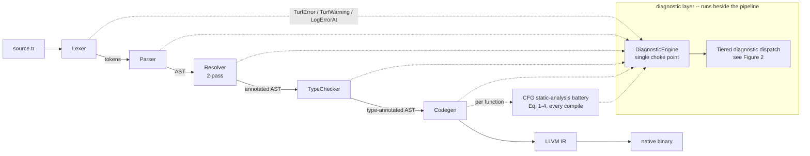
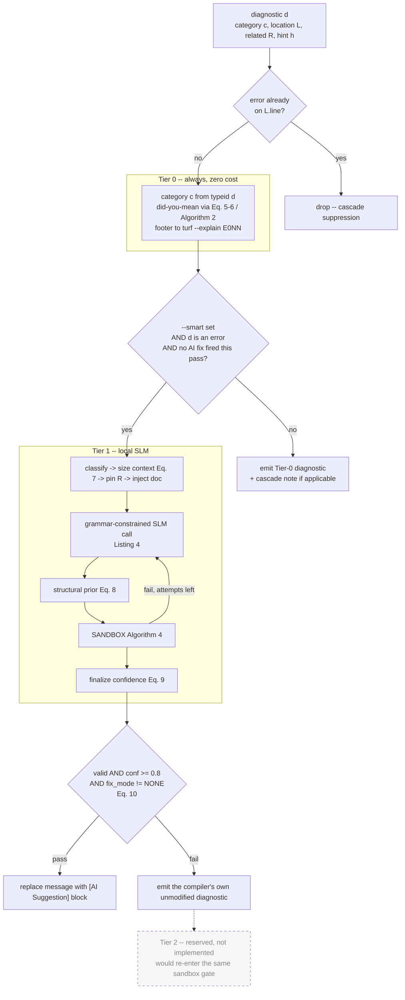
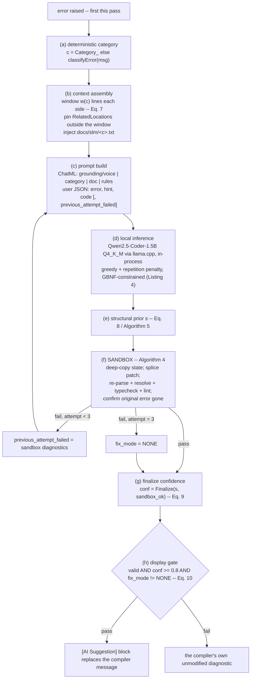
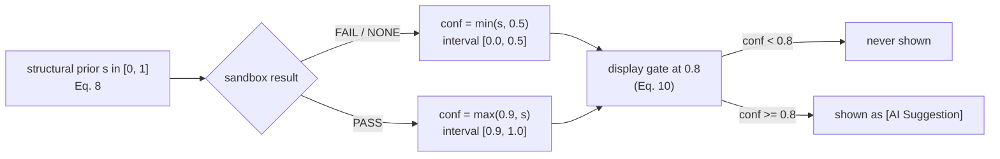

# Figures — Mermaid source

Renderable source for the five methodology figures. Paste a block into
<https://mermaid.live> (or any Mermaid renderer) and export SVG/PNG for the
paper. ASCII equivalents are inline in `03_methodology.md`.

---

## Figure 1 — The compiler and its diagnostic layer

---

## Figure 2 — Tiered diagnostic dispatch (per raised diagnostic)

---

## Figure 3 — The `--smart` Tier-1 pipeline

---

## Figure 4 — Sandbox lifecycle

```mermaid
stateDiagram-v2
    [*] --> Snapshot : DeepCopy(source, AST, symbol table)
    note right of Snapshot
        original snapshot retained
        for rollback
    end note
    Snapshot --> Patched : applyFix(lo, hi, replacement_line)
    Patched --> Validating : validate()  (full re-parse + resolve + typecheck + lint)
    Validating --> Decision : capture all diagnostics
    Decision --> Committed : no error-level diag AND isOriginalErrorResolved(errorLine)
    Decision --> Rejected : otherwise
    Committed --> [*] : commitToMain()  (main state advances)
    Rejected --> [*] : reject()  (discard; original diagnostic stands)
```

---

## Figure 5 — The confidence transform

